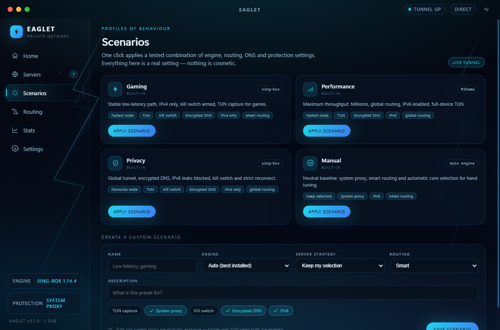

# Eaglet

**Fast. Private. Electric.** A desktop VPN client that drives **three real tunnel
cores** — [sing-box](https://sing-box.sagernet.org/), [Xray-core](https://github.com/XTLS/Xray-core)
and [Mihomo](https://github.com/MetaCubeX/mihomo) — with six swappable interface
styles.


## What actually works

Eaglet is not a mock-up. It generates a native configuration for the selected
core, validates it with that core, spawns it, verifies the exit address through
the local inbound and restores every system change on disconnect or crash.

- **Real profiles** — import a subscription URL, a base64 node list, a QR code or
  a single share link. VLESS (incl. Reality), VMess, Trojan, Shadowsocks,
  Hysteria2, TUIC, SOCKS, HTTP and a built-in direct route are supported.
- **Three real engines** — install, update, remove and version-check sing-box,
  Xray-core and Mihomo from their GitHub releases. Each adapter owns its native
  JSON/YAML format, validation command and launch arguments.
- **Per-profile engine choice** — pin a node to one core, choose a global core,
  or leave it on **Auto**. Auto prefers an installed core that can carry the
  profile (including protocol *variants*) and the requested TUN mode. If a
  pinned core cannot carry the node, Eaglet says so and falls back to a
  compatible one instead of failing after spawn.
- **Real tunnel** — native config → `sing-box check` / `xray run -test` /
  `mihomo -t` → spawn → wait for the local inbound → probe the exit IP → apply
  system routing and protection.
- **Real exit-IP verification** — the public address is measured **before** the
  tunnel starts and again **through** it. Home shows both addresses and flags a
  change only when they differ.
- **Real system routing** — WinINET proxy on Windows, `networksetup` on macOS
  and GSettings on GNOME. The previous state is backed up and restored on
  disconnect, quit or after a crash. Unsupported desktops fail loudly.
- **Network Protection** — a real kill switch (Windows Firewall policy, macOS
  `pf` anchor, Linux `iptables` chain) plus a local DoH relay. Both require an
  elevated process and report honestly when elevation is missing.
- **DNS Protection** — a real DNS-over-HTTPS relay on `127.0.0.1:53`; the system
  resolver is backed up, pointed at the relay and restored afterwards.
- **TUN capture** — sing-box and Mihomo can capture the whole device. On Windows
  Eaglet downloads `wintun.dll` once, stages the core next to it and requires an
  administrator session. Xray-core declares that it has no TUN mode.
- **Real telemetry** — Clash API for sing-box/Mihomo and Xray’s native
  `StatsService` (`xray api statsquery`) for Xray. Latency, jitter, packet loss,
  CPU and RAM of the core process are measured, not drawn.
- **Diagnostics and comparison** — a live health report (binary, version,
  config, proxy, TUN, kill switch, DNS, resolution, exit IP, latency, loss,
  stale subscriptions, engine updates, platform support), per-engine session
  comparison and an engine-switch history with the reason for every switch.
- **Scenarios** — built-in Gaming, Performance, Privacy and Manual presets plus
  custom ones. Applying a scenario writes real settings, picks a server strategy
  and can switch the engine; nothing is cosmetic.
- **World map** — coordinates come from a real DNS + `ip-api` batch lookup of the
  node addresses. Nothing is invented client-side.
- **Happ-style conveniences** — subscription refresh/removal and scheduled
  auto-update, latency tests, search, per-node connect, auto-connect on launch,
  launch at startup, tray mode, compact always-on-top mode, DNS selection and
  six themes.
- **Quick connect** — pings a bounded sample of nodes in parallel and connects to
  the fastest one, preferring nodes you starred.
- **Favourites and clipboard** — pin any node with a star, copy its share link,
  and paste a link or subscription URL straight from the clipboard.
- **Real speed test** — downloads 10 MB through the live tunnel and reports the
  measured Mbps; nothing is simulated.
- **Session history** — every finished session is persisted with duration,
  traffic totals, latency/jitter/loss, exit IP and the engine that carried it
  (last 40), with one-click clearing.
- **Split tunneling** — an always-direct bypass list of domains, IPs and CIDRs
  that wins in both Smart and Global routing.
- **Auto-reconnect** — after an unexpected core crash Eaglet retries three times
  with a growing delay and restores protection and the system proxy.
- **Backup and export** — settings, profiles, subscriptions and scenarios can be
  exported/imported as JSON; the active core configuration can be exported as a
  native file.
- **QR import** — decodes one or more QR payloads from an image with `jsqr`.
- **Desktop notifications and tray** — connect, disconnect, drop and
  exit-IP-change events reach the OS notification centre.

> **Verified platform.** The full matrix below was exercised on Windows 11 x64.
> macOS and Linux paths exist but are marked **experimental** until they are
> tested on real machines. Xray-core has no TUN implementation, and Xray only
> supports AEAD Shadowsocks ciphers — legacy ciphers such as `aes-256-cfb` are
> detected before the engine is selected.

> **Bring your own server.** The repository contains no VPN subscription. To
> exercise the mechanics without one, import `direct://Test` — the tunnel,
> proxy, telemetry and IP probes are real, but the exit address cannot change
> because traffic leaves from your own machine. Add a real node (or any
> subscription) and the IP-change badge will verify it.

> **Public nodes are untrusted.** The finder proves that a node carries HTTP
> traffic — not that its operator is honest. Never sign in to banking, work or
> other sensitive accounts through a free public node.

## Engines

| Engine | Protocols | Telemetry | TUN | Notes |
| --- | --- | --- | --- | --- |
| sing-box | VLESS, VMess, Trojan, SS, Hysteria2, TUIC, SOCKS, HTTP, direct | Clash API | yes | bundled with `npm run core` |
| Xray-core | VLESS, VMess, Trojan, AEAD SS, SOCKS, HTTP, direct | native StatsService | no | legacy SS ciphers rejected up front |
| Mihomo | VLESS, VMess, Trojan, SS, Hysteria2, TUIC, SOCKS, HTTP, direct | Clash API | yes | YAML config |

Engines are installed into `userData/bin` from the official GitHub releases and
can be updated or removed without touching the other two. The app never claims a
platform feature it does not implement.

## Telemetry that is measured, not drawn


Speed, totals, latency and per-session history come from the running core’s
native telemetry and from real HTTP transfers through the active tunnel. The
speed test downloads a fixed 10 MB payload. Jitter is the mean absolute
difference between consecutive latency probes; loss is the share of failed
probes in the rolling window. CPU and memory come from the actual core PID.

## Scenarios



A scenario is a tested bundle of real settings: engine, routing mode, DNS mode,
IPv6, TUN, system proxy, kill switch, DNS protection, auto-reconnect and server
strategy. Built-in presets can be applied in one click; custom presets can be
saved and removed.

## Interface styles

Six complete themes ship in the box and switch live from Settings.

<table>
  <tr>
    <td width="50%"></td>
    <td width="50%"></td>
  </tr>
  <tr>
    <td><b>Electric Cyber</b> — electric blue on deep space</td>
    <td><b>Glassmorphism</b> — frosted layers, violet light</td>
  </tr>
  <tr>
    <td></td>
    <td></td>
  </tr>
  <tr>
    <td><b>Minimal Dark</b> — quiet, typographic, precise</td>
    <td><b>HUD / Scifi</b> — telemetry green on black</td>
  </tr>
  <tr>
    <td></td>
    <td></td>
  </tr>
  <tr>
    <td><b>Neon Purple</b> — violet bloom after dark</td>
    <td><b>Nature Aurora</b> — northern lights over teal</td>
  </tr>
</table>

## Quick start

```bash
npm install
npm run core      # downloads sing-box into resources/bin (once)
npm run dev       # development session with HMR
npm run build     # production bundles into out/
npm start         # preview the production build
```

Other scripts: `npm run typecheck`, `npm run map` (regenerate the world map),
`npm run shots` (capture the screenshots), `npm run package` (unpacked build) and
`npm run dist` (installers).

Xray-core and Mihomo are downloaded on demand from their official releases. The
bundled `resources/bin` is copied into the packaged app via `extraResources`, so
run `npm run core` before `npm run dist`. If the bundled binary is missing at
runtime, Eaglet can install a core into `userData/bin` on the first connection.

## Verified matrix (Windows 11 x64, 2026-11-12)

`electron . --eaglet-engine-test` writes `engine-test.json` and exercises the
whole batch against a real Shadowsocks node (FR):

- install/version: sing-box 1.14.4, Xray-core 26.11.9, Mihomo 1.19.34;
- native config validation in standard and hardened variants for all three;
- real tunnel per engine, exit IP verified, telemetry counters moving;
- forced `taskkill` of each core → auto-reconnect restored the tunnel;
- per-profile pin, global engine and Auto selection;
- scenarios mutating real settings;
- system proxy applied and restored to the exact previous state;
- TUN prerequisites (wintun + staged core) prepared;
- emergency shutdown with a live tunnel: core stopped, proxy restored, sessions
  persisted.

Kill switch, system DNS override and actual TUN adapter capture require
administrator rights. Without elevation the harness records
`protection.skipped` instead of pretending they ran.

## Project structure

```
src/shared   IPC contract and domain types
src/main     Electron main process
  store.ts            settings, profiles, subscriptions, scenarios, sessions
  vpn/engine.ts       state machine, connect/teardown, telemetry, protection, diagnostics
  vpn/singbox.ts      sing-box config, Clash API, speed transfer, port helpers
  vpn/engines/        EngineManager + sing-box / Xray / Mihomo adapters
  vpn/firewall/       Windows Firewall, macOS pf and Linux iptables kill switch
  vpn/dns-guard.ts    local DoH relay and system resolver backup/restore
  vpn/system-proxy/   WinINET, networksetup and GSettings backends
  vpn/scenarios.ts    built-in connection scenarios
  vpn/profiles.ts     share-link, subscription and QR payload parser
  vpn/free-sources.ts public catalogs, TCP probe, live node verification
  vpn/geo.ts          DNS + ip-api geolocation
  vpn/process-usage.ts CPU/RAM sampler for the core process
  vpn/engine-test.ts  dev harness for the full engine matrix
src/preload  contextBridge API (window.eaglet)
src/renderer React interface — components, pages, themes
resources    core binaries and build resources (bin/ is git-ignored)
```

See [CLAUDE.md](CLAUDE.md) for architecture notes, the theme system and the
IPC contract.

## License

MIT
