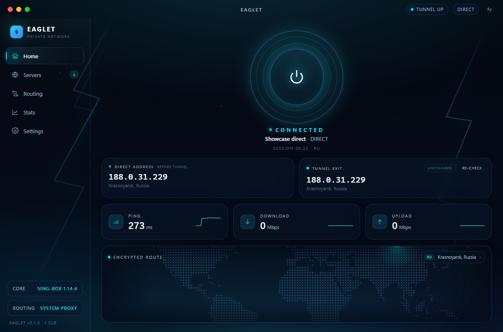
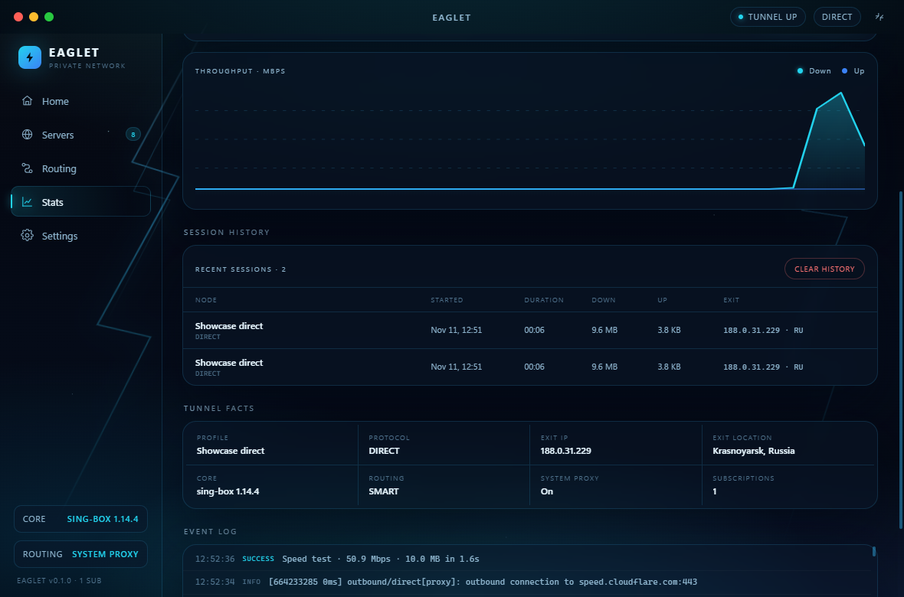
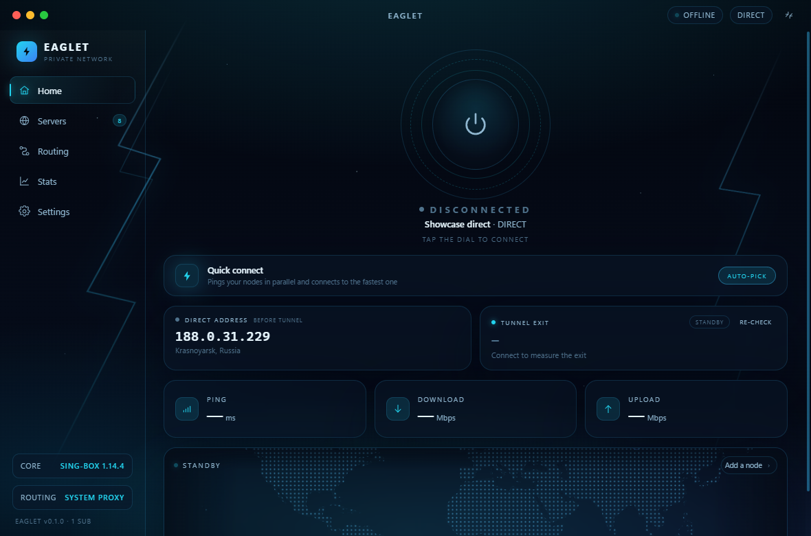
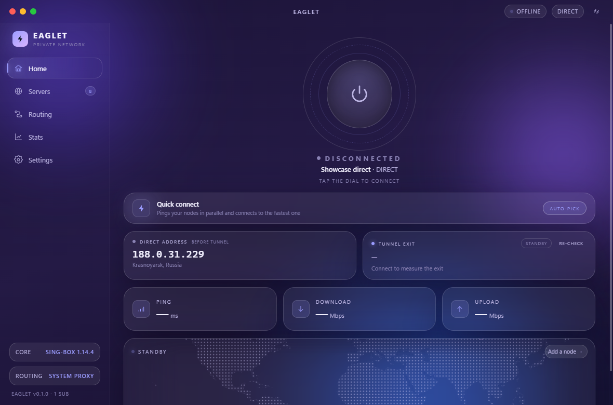
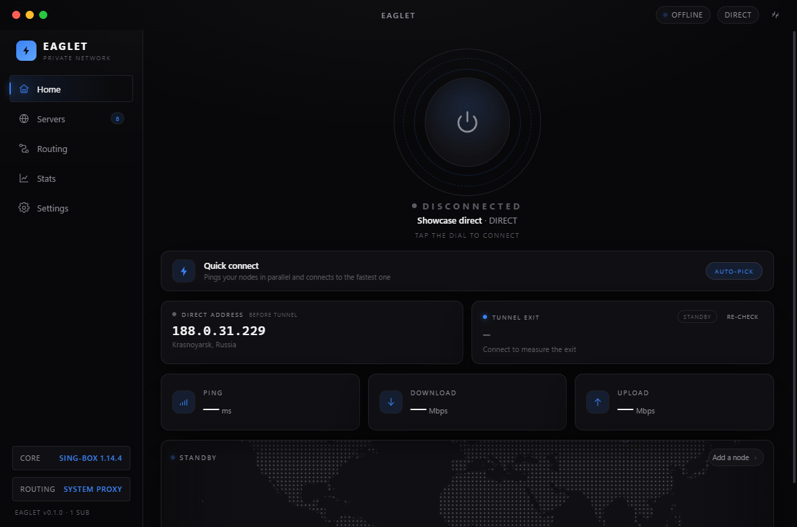
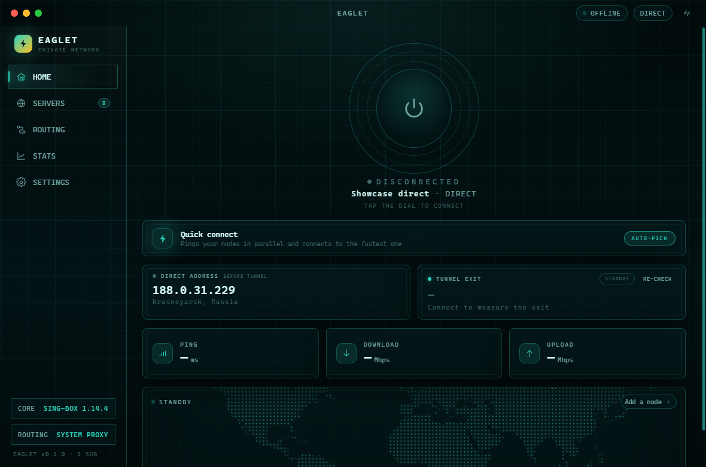
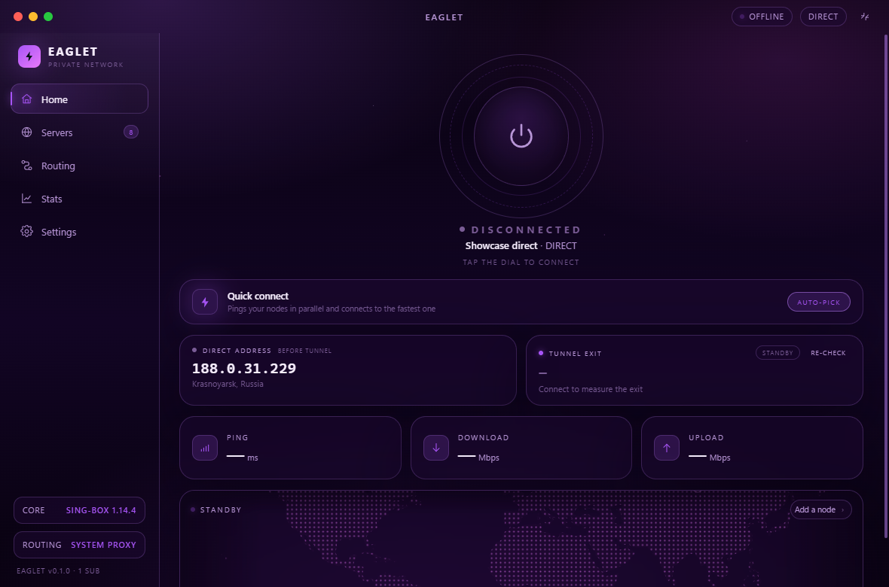
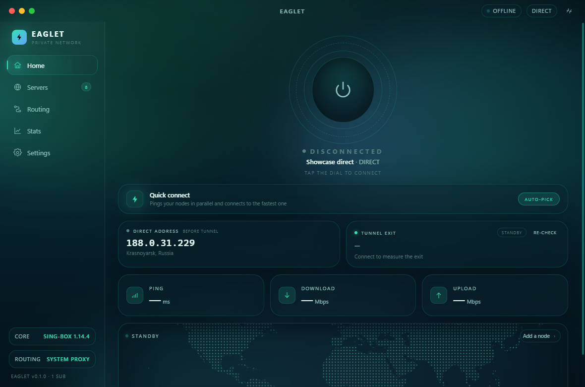

# Eaglet

**Fast. Private. Electric.** A desktop VPN client on the **sing-box** core with
six swappable interface styles.



## What actually works

Eaglet is not a mock-up. The app bundles the real [sing-box](https://sing-box.sagernet.org/)
core (1.14.x) and drives it end to end:

- **Real profiles** — import a subscription URL, a base64 node list, or a single
  share link. VLESS (incl. Reality), VMess, Trojan, Shadowsocks, Hysteria2,
  TUIC, SOCKS, HTTP and a built-in direct route are supported.
- **Real tunnel** — Eaglet generates a core config, validates it with
  `sing-box check`, spawns the core, waits for the local mixed inbound and
  restores everything on disconnect or crash.
- **Real exit-IP verification** — the public address is measured **before** the
  tunnel starts and again **through** the tunnel. Home shows both addresses and
  flags a change only when they differ.
- **Real system routing** — one click flips the Windows WinINET proxy to the
  local inbound, with a backup of the previous settings; the backup is restored
  on disconnect, quit or after a crash. TUN mode is available for full-device
  capture (requires an administrator session).
- **Real telemetry** — download/upload speed, session totals, active
  connections and latency come from the core's Clash API; the event log streams
  the core's own output.
- **Happ-style conveniences** — subscription refresh/removal, latency tests,
  search, per-node connect, auto-connect on launch, launch at startup, compact
  always-on-top mode, DNS selection, kill-switch policy and six themes.
- **Quick connect** — pings a bounded sample of nodes in parallel and connects to
  the fastest one, preferring nodes you starred.
- **Favourites and clipboard** — pin any node with a star (favourites sort to the
  top and get their own filter), copy its share link, and paste a link or
  subscription URL straight from the clipboard.
- **Real speed test** — downloads 10 MB through the live tunnel and reports the
  measured Mbps; nothing is simulated.
- **Session history** — every finished session is persisted with duration,
  traffic totals and the exit IP (last 40), with one-click clearing.
- **Split tunneling** — an always-direct bypass list of domains, IPs and CIDRs
  that wins in both Smart and Global routing.
- **Auto-reconnect** — after an unexpected core crash Eaglet retries three times
  with a growing delay and restores the system proxy.
- **Desktop notifications** — connect, disconnect, drop and exit-IP-change events
  are surfaced through the OS notification centre.
- **Free-server finder** — *Servers → Find free servers* pulls open community
  catalogs from GitHub, deduplicates thousands of links, TCP-probes a sample and
  boots a throwaway sing-box instance for the fastest candidates. Only nodes
  that really return traffic are listed; the ones you pick are stored as a
  removable **Free public nodes** subscription.

> **Bring your own server.** The repository contains no VPN subscription. To
> exercise the mechanics without one, import `direct://Test` — the tunnel,
> proxy, telemetry and IP probes are real, but the exit address cannot change
> because traffic leaves from your own machine. Add a real node (or any
> subscription) and the IP-change badge will verify it.

> **Public nodes are untrusted.** The finder proves that a node carries HTTP
> traffic — not that its operator is honest. Never sign in to banking, work or
> other sensitive accounts through a free public node.

## Telemetry that is measured, not drawn



Speed, totals, latency and per-session history come from the core's Clash API
and from real HTTP transfers through the active tunnel. The speed test downloads
a fixed 10 MB payload, and each session records its duration, traffic and exit
address when the tunnel closes.

## Interface styles

Six complete themes ship in the box and switch live from Settings.

<table>
  <tr>
    <td width="50%"></td>
    <td width="50%"></td>
  </tr>
  <tr>
    <td><b>Electric Cyber</b> — electric blue on deep space</td>
    <td><b>Glassmorphism</b> — frosted layers, violet light</td>
  </tr>
  <tr>
    <td></td>
    <td></td>
  </tr>
  <tr>
    <td><b>Minimal Dark</b> — quiet, typographic, precise</td>
    <td><b>HUD / Scifi</b> — telemetry green on black</td>
  </tr>
  <tr>
    <td></td>
    <td></td>
  </tr>
  <tr>
    <td><b>Neon Purple</b> — violet bloom after dark</td>
    <td><b>Nature Aurora</b> — northern lights over teal</td>
  </tr>
</table>

## Quick start

```bash
npm install
npm run core      # downloads sing-box into resources/bin (once)
npm run dev       # development session with HMR
npm run build     # production bundles into out/
npm start         # preview the production build
```

Other scripts: `npm run typecheck`, `npm run map` (regenerate the world map),
`npm run shots` (capture one screenshot per theme), `npm run package`
(unpacked build) and `npm run dist` (installers).

Electron-builder copies `resources/bin` into the packaged app via
`extraResources`, so run `npm run core` before `npm run dist`. If the binary is
missing at runtime, Eaglet can download the latest sing-box release into its
user-data folder on the first connect.

## Project structure

```
src/shared   IPC contract and domain types
src/main     Electron main process
  store.ts            settings, profiles, subscriptions and sessions (userData/config.json)
  vpn/engine.ts       state machine, connect/teardown, IP probes, telemetry, sessions, auto-reconnect, speed test
  vpn/singbox.ts      core discovery/install, config builder (incl. bypass rules), process, Clash API, speed transfer
  vpn/profiles.ts     share-link and subscription parser
  vpn/system-proxy.ts Windows proxy enable/disable with backup/restore
src/preload  contextBridge API (window.eaglet)
src/renderer React interface — components, pages, themes
resources    core binaries and build resources (bin/ is git-ignored)
```

See [CLAUDE.md](CLAUDE.md) for architecture notes, the theme system and the
IPC contract.

## License

MIT
