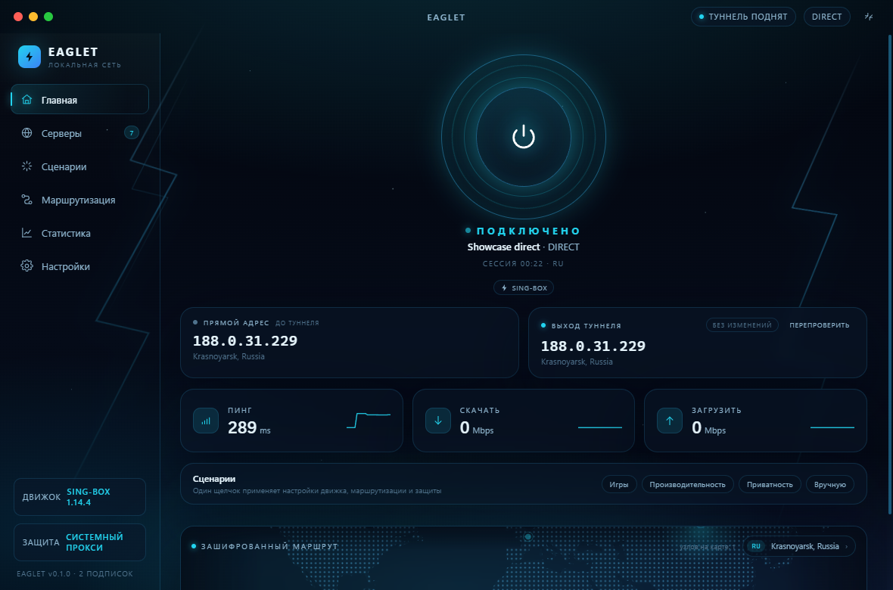
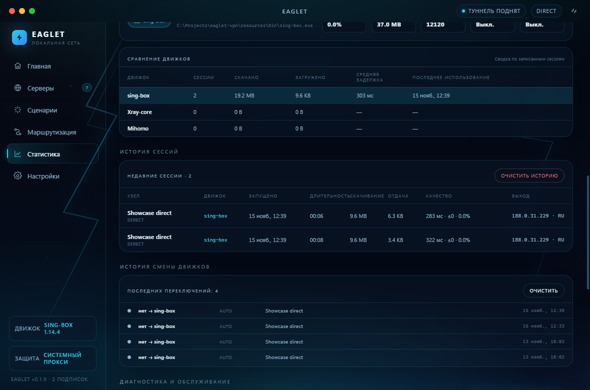
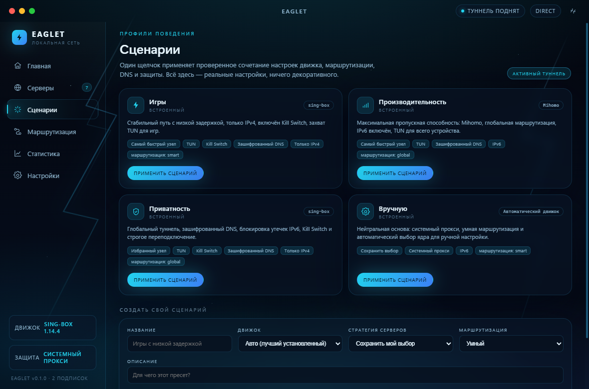
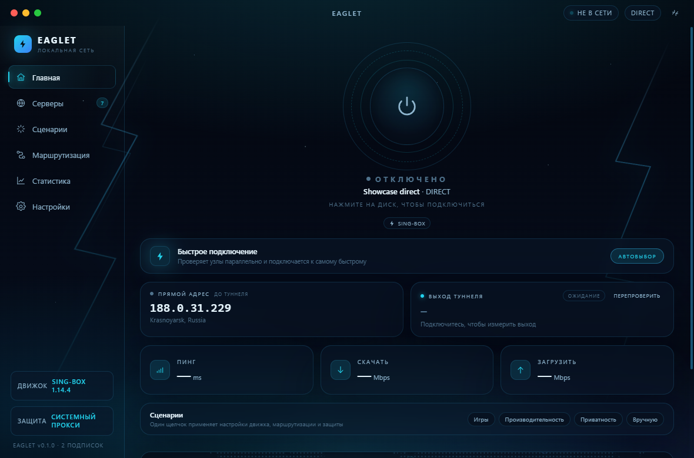
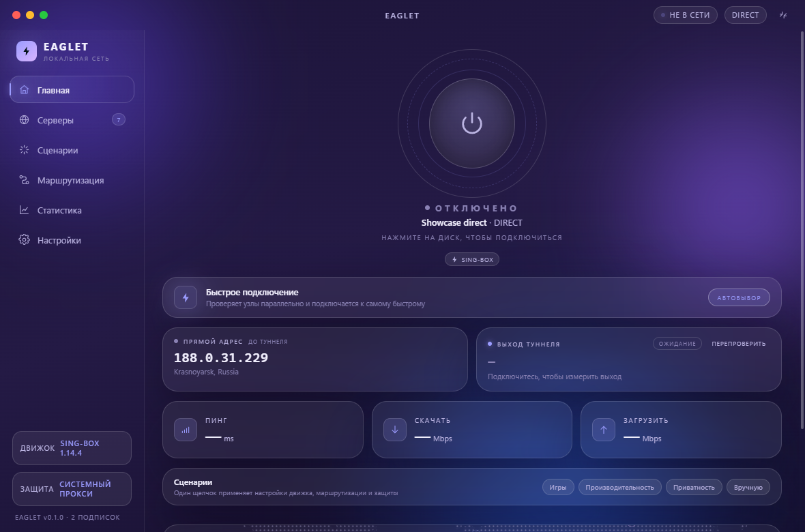
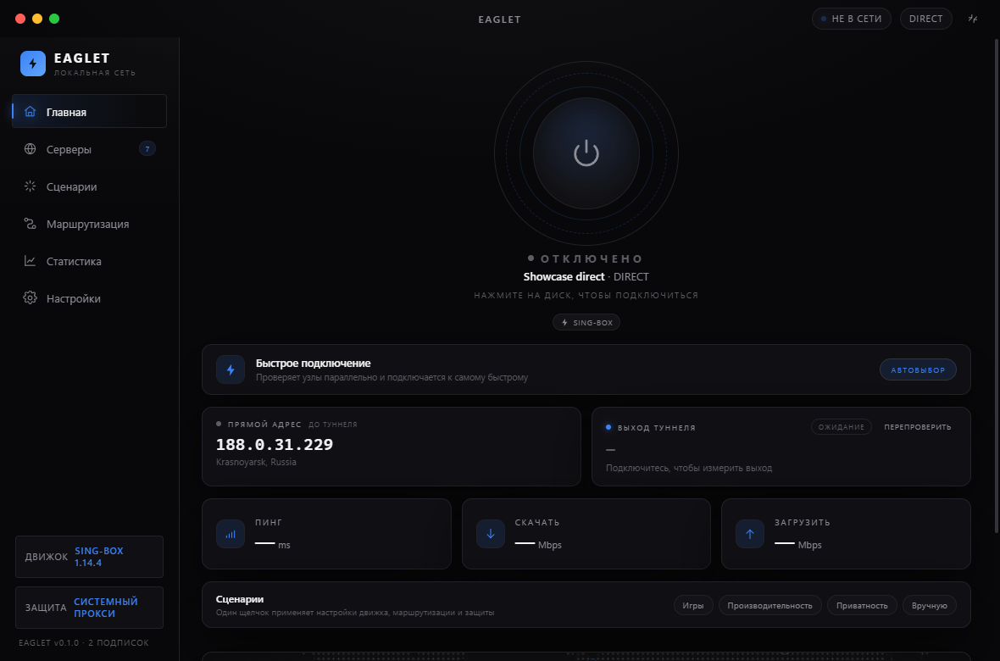
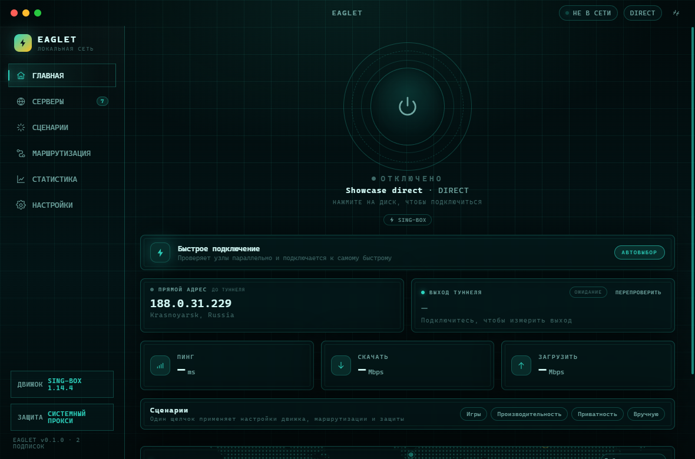
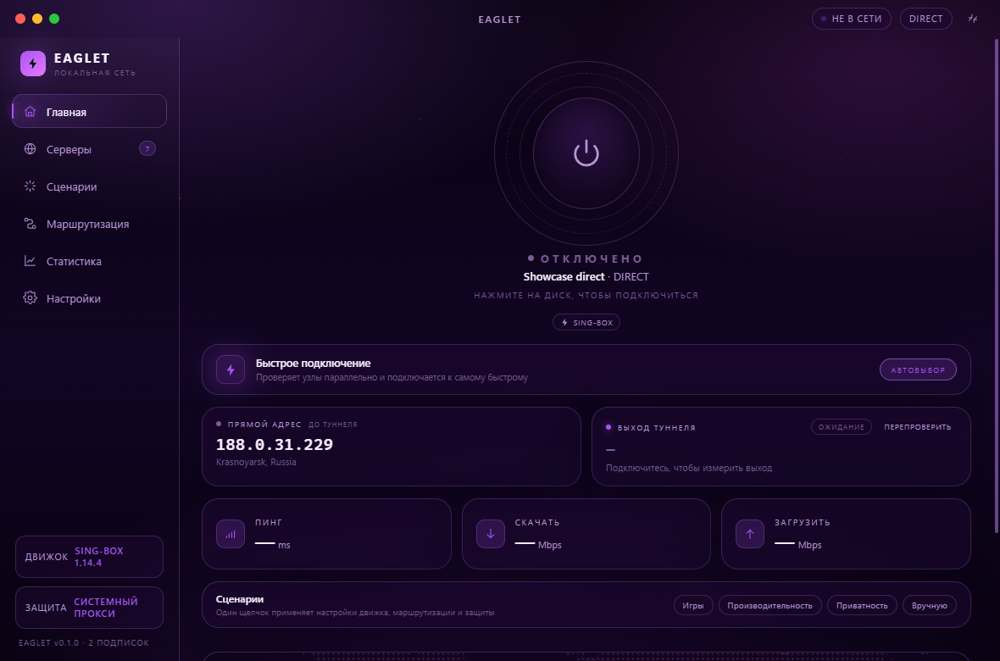
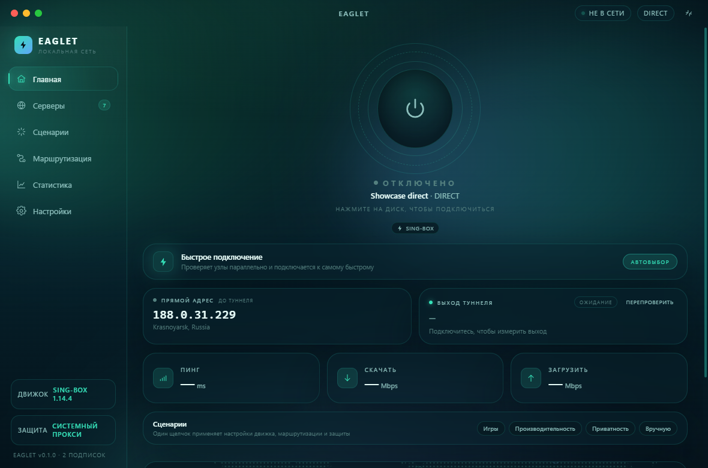

# Eaglet

**Быстро. Приватно. Электрически.** Настольный VPN-клиент, который управляет
**тремя настоящими туннельными ядрами** — [sing-box](https://sing-box.sagernet.org/),
[Xray-core](https://github.com/XTLS/Xray-core) и
[Mihomo](https://github.com/MetaCubeX/mihomo) — с шестью переключаемыми стилями
интерфейса.

[English version](README.md) · [Русская версия](README.ru.md)



## Что действительно работает

Eaglet — не макет. Он генерирует нативную конфигурацию для выбранного ядра,
проверяет её этим же ядром, запускает его, проверяет адрес выхода через локальный
входящий порт и восстанавливает все системные изменения при отключении или
аварийном завершении.

- **Настоящие профили** — импортируйте URL подписки, base64-список узлов, QR-код
  или одну ссылку-приглашение. Поддерживаются VLESS (включая Reality), VMess,
  Trojan, Shadowsocks, Hysteria2, TUIC, SOCKS, HTTP и встроенный прямой маршрут.
- **Три настоящих ядра** — установка, обновление, удаление и проверка версий
  sing-box, Xray-core и Mihomo из их релизов на GitHub. У каждого адаптера свой
  нативный формат JSON/YAML, команда проверки и аргументы запуска.
- **Выбор ядра для каждого профиля** — привяжите узел к одному ядру, выберите
  глобальное ядро или оставьте режим **Авто**. Авто предпочитает установленное
  ядро, способное обслужить профиль (включая *варианты* протокола) и требуемый
  режим TUN. Если привязанное ядро не может обслужить узел, Eaglet сообщает об
  этом и переходит на совместимое вместо отказа после запуска.
- **Настоящий туннель** — нативная конфигурация → `sing-box check` /
  `xray run -test` / `mihomo -t` → запуск → ожидание локального входящего порта →
  проверка IP выхода → применение системной маршрутизации и защиты.
- **Настоящая проверка IP выхода** — публичный адрес измеряется **до** запуска
  туннеля и снова **через** него. На главном экране показаны оба адреса, и смена
  отмечается только когда они различаются.
- **Настоящая системная маршрутизация** — прокси WinINET в Windows,
  `networksetup` в macOS и GSettings в GNOME. Предыдущее состояние сохраняется и
  восстанавливается при отключении, выходе или после сбоя. Неподдерживаемые
  окружения сообщают об ошибке явно.
- **Сетевая защита** — настоящий kill switch (политика Брандмауэра Windows,
  якорь `pf` в macOS, цепочки `iptables`/`ip6tables` в Linux) плюс локальный
  DoH-ретранслятор. Правила разрешают только loopback, DHCP/ND, IP и порт
  выбранного узла, закреплённые IP/порт DoH, разрешённые конечные точки
  подписок/обновлений на их реальных портах и — только когда DNS-защита
  **выключена** — прежние резолверы на порту 53. Правила Windows также привязаны
  к исполняемому файлу Eaglet/ядра; нет широкого исключения для `80/443` или
  «любой программы». Когда DNS-защита включена, все правила для открытого DNS
  удаляются, и единственным резолвером становится loopback-ретранслятор.
  Авто-переподключение сохраняет правила активными: ядро разрешает имена через
  ретранслятор (или уже разрешённые резолверы), а существующая политика — которая
  и так разрешает тот же узел — не трогается до подтверждения туннеля. Правила
  пересобираются из свежей резервной копии при следующем ручном подключении.
  Если все попытки не удались, правила остаются активными, пока пользователь не
  отключится. Защита работает по принципу **fail-closed**: если kill switch или
  DoH-ретранслятор включены, но не могут быть активированы (например, без прав
  администратора), подключение прерывается, а не поднимается незащищённым.
- **IPv6 по принципу fail-closed** — IPv6 блокируется даже для узлов, работающих
  только по IPv4. В Linux отсутствующий/нерабочий `ip6tables` прерывает весь
  kill switch (и удаляет цепочку IPv4), если только ядро действительно не
  отключило IPv6. macOS сохраняет предыдущее состояние `pf` и правила внутри
  собственного якоря Eaglet, а затем восстанавливает и то, и другое при
  отключении или сбое; основной набор правил пользователя никогда не заменяется.
- **Восстановление после сбоя** — Windows оставляет резервную копию политики,
  Linux — маркер `iptables`, macOS — резервную копию `pf`. При следующем запуске
  устаревшие правила удаляются, а исходное состояние исходящих подключений и
  резолверов восстанавливается до подключения.
- **DNS-защита** — настоящий двухстековый ретранслятор DNS-over-HTTPS на
  `127.0.0.1:53` и, если он успешно привязался, на `::1:53`. Конечная точка DoH
  разрешается в IP **до** перенаправления системного резолвера, а затем
  запрашивается по HTTPS с исходными SNI/Host и проверкой сертификата. Резолверы
  IPv4 и IPv6 сохраняются вместе и восстанавливаются перед остановкой
  ретранслятора; неудачное восстановление сохраняет резервную копию для
  следующего запуска, а loopback IPv6 объявляется только когда слушатель IPv6
  действительно существует.
- **Секреты не попадают в `config.json`** — ссылки-приглашения профилей и URL
  подписок шифруются с помощью Electron `safeStorage` (DPAPI/Keychain/libsecret)
  в отдельном атомарно записываемом хранилище. Base64 **не** считается
  шифрованием: если связка ключей ОС недоступна, хранилище отказывается
  записывать, а интерфейс сообщает `unavailable`; профиль остаётся рабочим,
  потому что его ссылка хранится в `config.json` с явным предупреждением об
  открытом тексте. Хранилище, которое невозможно расшифровать, никогда не
  переименовывается, не перезаписывается и не удаляется, поэтому профили и их
  метаданные сохраняются до восстановления связки ключей. IPC снимка никогда не
  включает необработанные ссылки или токены подписок; копирование ссылки и
  обновление подписки — операции главного процесса.
- **Укреплённая оболочка Electron** — изолированный рендерер, изоляция контекста,
  без интеграции Node, без webview, запрещены навигация и `window.open`, внешние
  ссылки ограничены http(s), проверка отправителя/главного фрейма при каждом
  вызове IPC, валидируемые полезные нагрузки IPC и строгий CSP для продакшена.
- **Захват TUN** — sing-box и Mihomo могут захватывать всё устройство. В Windows
  Eaglet один раз скачивает `wintun.dll`, размещает ядро рядом с ним и требует
  сессию администратора. Xray-core заявляет, что не имеет режима TUN.
- **Проверенные загрузки ядер** — каждый архив ядра должен совпадать с дайджестом
  SHA-256, опубликованным в релизе GitHub (или в его файле контрольных сумм), а
  бинарные файлы Windows проверяются с помощью Authenticode (неподписанные сборки
  принимаются, подделанная подпись — нет). `wintun.dll` сверяется с закреплённым
  дайджестом.
- **Переключение ядер на лету** — выбор другого ядра при активном подключении
  останавливает текущее ядро, ждёт его выхода (чтобы освободить адаптеры TUN),
  запускает новое и откатывается к предыдущему ядру, если новый туннель не
  заработал.
- **Настоящая телеметрия** — Clash API для sing-box/Mihomo и нативный
  `StatsService` Xray (`xray api statsquery`) для Xray. Задержка, джиттер, потери
  пакетов, CPU и RAM процесса ядра измеряются, а не рисуются.
- **Диагностика и сравнение** — живой отчёт о состоянии (бинарник, версия,
  конфигурация, прокси, TUN, kill switch, DNS, разрешение имён, IP выхода,
  задержка, потери, устаревшие подписки, обновления ядер, поддержка платформы),
  сравнение сессий по ядрам и история переключений ядер с причиной каждого
  переключения.
- **Сценарии** — встроенные пресеты «Игры», «Производительность»,
  «Приватность» и «Вручную» плюс пользовательские. Применение сценария записывает
  реальные настройки, выбирает стратегию сервера и может переключить ядро; ничего
  косметического.
- **Карта мира** — координаты берутся из реального пакетного запроса DNS +
  `ip-api` по адресам узлов. На стороне клиента ничего не выдумывается.
- **Удобства в стиле Happ** — обновление/удаление подписок и запланированное
  авто-обновление, тесты задержки, поиск, подключение к отдельному узлу,
  авто-подключение при запуске, запуск при входе в систему, режим трея, компактный
  режим поверх всех окон, выбор DNS, шесть тем и полностью двуязычный интерфейс
  (русский по умолчанию, английский — в настройках).
- **Быстрое подключение** — параллельно пингует ограниченную выборку узлов и
  подключается к самому быстрому, отдавая предпочтение узлам, которые вы отметили
  звездой.
- **Избранное и буфер обмена** — отметьте любой узел звездой, скопируйте его
  ссылку-приглашение и импортируйте ссылку или URL подписки прямо из буфера
  обмена. Обе операции выполняются в главном процессе, поэтому рендерер никогда не
  видит секрет.
- **Настоящий тест скорости** — скачивает 10 МБ через живой туннель и сообщает
  измеренные Мбит/с; ничего не симулируется.
- **История сессий** — каждая завершённая сессия сохраняется с длительностью,
  объёмами трафика, задержкой/джиттером/потерями, IP выхода и ядром, которое её
  обслуживало (последние 40), с очисткой в один клик.
- **Раздельное туннелирование** — список обхода, всегда идущий напрямую, из
  доменов, IP и CIDR, который имеет приоритет и в «Умной», и в «Глобальной»
  маршрутизации.
- **Авто-переподключение** — после неожиданного сбоя ядра Eaglet повторяет попытки
  три раза с растущей задержкой, пока kill switch/DNS-защита остаются активными,
  а затем восстанавливает туннель и системный прокси. Если все попытки не удались,
  прямой доступ остаётся заблокированным, пока вы не отключитесь.
- **Резервное копирование и экспорт** — настройки, профили, подписки и сценарии
  можно экспортировать/импортировать как JSON; конфигурацию активного ядра можно
  экспортировать как нативный файл. Диалог резервного копирования объясняет, что
  ссылки-приглашения и URL подписок могут содержать учётные данные, и предлагает
  экспорт **без секретов**. При экспорте конфигурации ядра всегда выводится
  предупреждение, что файл содержит учётные данные в открытом виде.
- **Импорт QR** — декодирует одну или несколько полезных нагрузок QR из
  изображения с помощью `jsqr`.
- **Уведомления на рабочем столе и трей** — события подключения, отключения,
  сбоя и смены IP выхода попадают в центр уведомлений ОС.

> **Проверенная платформа.** Полная матрица ниже была проверена на Windows 11 x64.
> Пути macOS и Linux существуют, но помечены как **экспериментальные**, пока не
> протестированы на реальных машинах. У Xray-core нет реализации TUN, и Xray
> поддерживает только шифры AEAD Shadowsocks — устаревшие шифры вроде
> `aes-256-cfb` определяются до выбора ядра.

> **Свой сервер.** В репозитории нет VPN-подписки. Чтобы опробовать механику без
> неё, импортируйте `direct://Test` — туннель, прокси, телеметрия и проверки IP
> настоящие, но адрес выхода не может измениться, потому что трафик уходит с вашей
> собственной машины. Добавьте реальный узел (или любую подписку), и значок смены
> IP это подтвердит.

> **Публичные узлы не заслуживают доверия.** Поисковик доказывает, что узел
> пропускает HTTP-трафик, — но не то, что его оператор честен. Никогда не входите
> в банковские, рабочие или другие чувствительные аккаунты через бесплатный
> публичный узел.

> **Область действия kill switch.** Брандмауэр управляет новыми исходящими
> потоками. В Windows уже установленное соединение может сохраниться до закрытия,
> потому что Windows Filtering Platform хранит состояния разрешений; Eaglet не
> поставляет драйвер-колаут ядра. Linux и macOS применяют правила на уровне
> пакетов, но не могут ограничить исключение одним процессом без дополнительных
> cgroups/помощников. Все три бэкенда требуют прав администратора; macOS также
> ожидает стандартный `anchor "com.apple/*"` в `/etc/pf.conf`. Ручные отключения и
> явные переключения ядер по своей природе восстанавливают прямое сетевое
> взаимодействие.

## Ядра

| Ядро | Протоколы | Телеметрия | TUN | Примечания |
| --- | --- | --- | --- | --- |
| sing-box | VLESS, VMess, Trojan, SS, Hysteria2, TUIC, SOCKS, HTTP, direct | Clash API | да | поставляется с `npm run core` |
| Xray-core | VLESS, VMess, Trojan, AEAD SS, SOCKS, HTTP, direct | нативный StatsService | нет | устаревшие шифры SS отклоняются заранее |
| Mihomo | VLESS, VMess, Trojan, SS, Hysteria2, TUIC, SOCKS, HTTP, direct | Clash API | да | конфигурация YAML |

Ядра устанавливаются в `userData/bin` из официальных релизов GitHub и могут быть
обновлены или удалены, не затрагивая два других. Приложение никогда не заявляет о
возможности платформы, которую не реализует.

## Телеметрия, которая измеряется, а не рисуется



Скорость, объёмы, задержка и история по сессиям берутся из нативной телеметрии
работающего ядра и из реальных HTTP-передач через активный туннель. Тест скорости
скачивает фиксированные 10 МБ. Джиттер — это средняя абсолютная разница между
последовательными пробами задержки; потери — доля неудачных проб в скользящем
окне. CPU и память берутся из реального PID ядра.

## Сценарии



Сценарий — это проверенный набор реальных настроек: ядро, режим маршрутизации,
режим DNS, IPv6, TUN, системный прокси, kill switch, DNS-защита,
авто-переподключение и стратегия сервера. Встроенные пресеты применяются в один
клик; пользовательские можно сохранять и удалять.

## Стили интерфейса

Шесть полноценных тем идут в комплекте и переключаются на лету в Настройках.

<table>
  <tr>
    <td width="50%"></td>
    <td width="50%"></td>
  </tr>
  <tr>
    <td><b>Electric Cyber</b> — электрический синий в глубоком космосе</td>
    <td><b>Glassmorphism</b> — матовые слои, фиолетовый свет</td>
  </tr>
  <tr>
    <td></td>
    <td></td>
  </tr>
  <tr>
    <td><b>Minimal Dark</b> — тихо, типографично, точно</td>
    <td><b>HUD / Scifi</b> — зелёная телеметрия на чёрном</td>
  </tr>
  <tr>
    <td></td>
    <td></td>
  </tr>
  <tr>
    <td><b>Neon Purple</b> — фиолетовое свечение после заката</td>
    <td><b>Nature Aurora</b> — северное сияние над бирюзой</td>
  </tr>
</table>

## Быстрый старт

```bash
npm install
npm run core      # downloads sing-box into resources/bin (once)
npm run dev       # development session with HMR
npm run build     # production bundles into out/
npm start         # preview the production build
```

Другие скрипты: `npm run typecheck`, `npm test` (модульные тесты Vitest),
`npm run lint` (ESLint), `npm run map` (перегенерировать карту мира),
`npm run shots` (снять скриншоты), `npm run package` (нераспакованная сборка) и
`npm run dist` (установщики).

Xray-core и Mihomo скачиваются по требованию из их официальных релизов.
Поставляемый `resources/bin` копируется в упакованное приложение через
`extraResources`, поэтому запустите `npm run core` перед `npm run dist`. Если
поставляемый бинарник отсутствует во время выполнения, Eaglet может установить
ядро в `userData/bin` при первом подключении.

## Проверенная матрица (Windows 11 x64, 2026-11-12)

`electron . --eaglet-engine-test` записывает `engine-test.json` и прогоняет весь
пакет против реального узла Shadowsocks (FR):

- установка/версия: sing-box 1.14.4, Xray-core 26.11.9, Mihomo 1.19.34;
- проверка нативной конфигурации в стандартном и укреплённом вариантах для всех
  трёх;
- реальный туннель для каждого ядра, IP выхода проверен, счётчики телеметрии
  движутся;
- принудительный `taskkill` каждого ядра → авто-переподключение восстановило
  туннель;
- привязка на уровне профиля, глобальное ядро и выбор «Авто»;
- сценарии, изменяющие реальные настройки;
- системный прокси применён и восстановлен к точному прежнему состоянию;
- предпосылки TUN (wintun + подготовленное ядро) подготовлены;
- аварийное завершение при живом туннеле: ядро остановлено, прокси восстановлен,
  сессии сохранены.

Kill switch, системное переопределение DNS и фактический захват адаптера TUN
требуют прав администратора. Без повышения прав пакет записывает
`protection.skipped`, а не делает вид, что они выполнялись.

### Статус аудита (2026-11-17)

- `npm run typecheck` и набор Vitest (18 файлов, 255 тестов) проходят на
  Windows 11 x64.
- Пути Windows kill switch, резервного копирования/восстановления DNS и
  восстановления после сбоя покрыты модульными тестами; последняя полная
  матрица с живым туннелем выше остаётся эталоном реального прогона.
- Обработка Linux `iptables`/`ip6tables`, разбор системных DNS-настроек и
  восстановление по маркеру проверены только статическим анализом и модульными
  тестами с заглушками. На реальном Linux-хосте они **не запускались**; считайте
  их экспериментальными.
- Пути macOS `pf` и системного DNS проверены ревью и модульными тестами с
  заглушками, но не запускались на реальном Mac.

## Структура проекта

```
src/shared   IPC contract and domain types
src/main     Electron main process
  store.ts            settings, profiles, subscriptions, scenarios, sessions
  vpn/engine.ts       state machine, connect/teardown, telemetry, protection, diagnostics
  vpn/singbox.ts      sing-box config, Clash API, speed transfer, port helpers
  vpn/engines/        EngineManager + sing-box / Xray / Mihomo adapters
  vpn/firewall/       Windows Firewall, macOS pf and Linux iptables kill switch
  vpn/dns-guard.ts    local DoH relay and system resolver backup/restore
  vpn/system-proxy/   WinINET, networksetup and GSettings backends
  vpn/scenarios.ts    built-in connection scenarios
  vpn/profiles.ts     share-link, subscription and QR payload parser
  vpn/free-sources.ts public catalogs, TCP probe, live node verification
  vpn/geo.ts          DNS + ip-api geolocation
  vpn/process-usage.ts CPU/RAM sampler for the core process
  vpn/engine-test.ts  dev harness for the full engine matrix
src/preload  contextBridge API (window.eaglet)
src/renderer React interface — components, pages, themes
resources    core binaries and build resources (bin/ is git-ignored)
```

См. [CLAUDE.ru.md](CLAUDE.ru.md), чтобы узнать об архитектуре, системе тем и
контракте IPC.

## Лицензия

MIT
